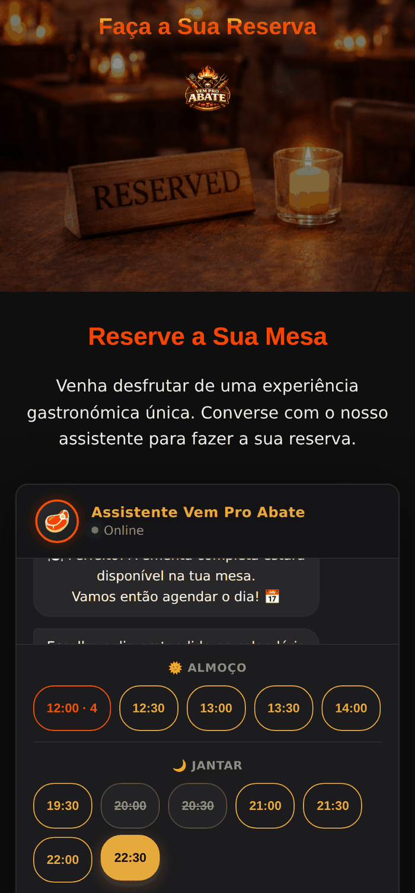
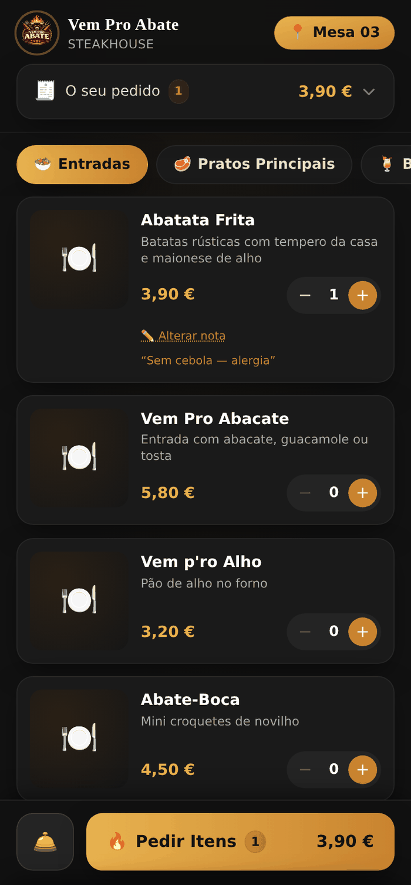
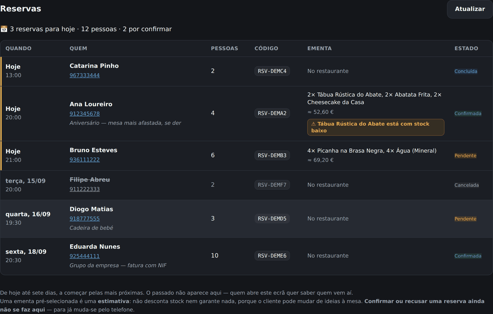
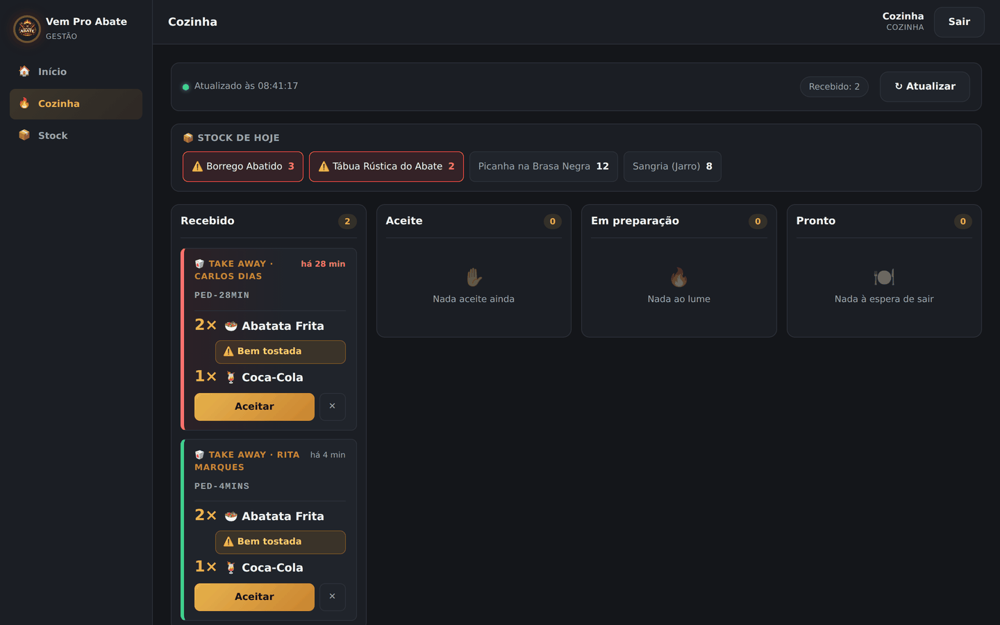
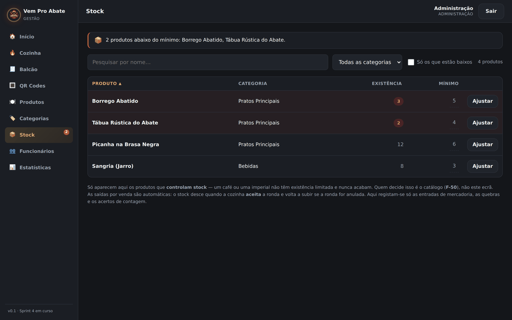
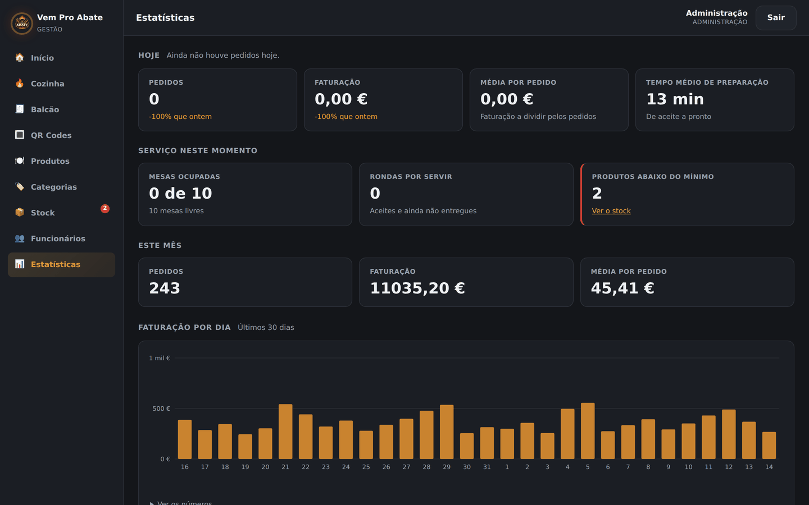

# Manual de Utilização — Vem Pro Abate

*Sistema de gestão de restaurante. Duas aplicações, uma base de dados.*

Este manual está dividido em duas partes, porque são duas pessoas
diferentes a usar o sistema:

- **[Parte 1 — Para quem é cliente](#parte-1--para-quem-é-cliente)**, no
  telemóvel ou no computador, sem instalar nada e sem criar conta.
- **[Parte 2 — Para quem trabalha no restaurante](#parte-2--para-quem-trabalha-no-restaurante)**,
  na aplicação de gestão, com uma conta.

No fim há duas secções que valem a leitura mesmo a quem já sabe usar
tudo: **[Coisas que vão acontecer e não são avarias](#coisas-que-vão-acontecer-e-não-são-avarias)**
e **[Limites conhecidos](#limites-conhecidos)**.

---

# Parte 1 — Para quem é cliente

Endereço do site: **vemproabate.vercel.app**

Não é preciso instalar aplicação nenhuma nem criar conta. O site
funciona no telemóvel, no tablet e no computador.

## 1.1 Ver a ementa

**Menu** na barra de cima.

A ementa é lida da base de dados no momento em que a página abre. Não é
uma imagem nem um PDF: quando o restaurante muda um preço no ecrã de
gestão, o site muda no recarregamento seguinte. Não há duas versões da
ementa para se desencontrarem.

Cada prato mostra o nome, a descrição, o preço e a fotografia. Produtos
desativados na gestão não aparecem aqui.

## 1.2 Reservar mesa

**Reservas** na barra de cima.

A reserva faz-se por conversa, uma pergunta de cada vez:

1. **Quantas pessoas.** Acima de **10** o sistema pede que se telefone, e
   oferece um botão que liga — um grupo grande precisa de conversa, não
   de formulário. O botão "Somos mais" pergunta quantos são em vez de
   assumir: quem for 7 ou 8 continua pelo site.
2. **Com ou sem pré-escolha da ementa.** Escolher no restaurante é o
   caminho normal; pré-escolher serve para grupos e para quem quer
   estimar o valor de antemão.
3. **O dia**, num calendário. Segunda-feira está fechada e aparece
   marcada como tal. Aceitam-se reservas de amanhã até 60 dias.
4. **A hora.** As horas sem lugares aparecem **a cinzento e riscadas** e
   não se podem escolher. As que têm poucos lugares mostram o número ao
   lado — se forem seis pessoas e sobrarem dois lugares, dá para ver
   antes de escrever o nome.
5. **Nome e telemóvel.** O telemóvel são nove dígitos começados em 9.
   Pode escrever-se com espaços (`912 345 678`) e aceita o indicativo
   do país à frente (`+351912345678`).
6. **Confirmar** no resumo, que mostra tudo antes de gravar.

*O passo das horas. As cheias aparecem a cinzento e riscadas, e as que têm
poucos lugares mostram quantos sobram.*

No fim aparece um **código de reserva** (por exemplo `RSV-K4M2P`) em
destaque, com um botão para copiar.

> **Guarde o código.** É por ele que a reserva se identifica ao telefone
> ou à chegada.

A reserva fica **pendente** e o restaurante confirma por telefone. O
sistema não diz "confirmada" no fim, e é de propósito: quem confirma é
uma pessoa.

Se escolheu pratos, aparece também um **valor estimado**. É uma
estimativa calculada pelo servidor com os preços do dia — o que conta é
a conta no fim.

## 1.3 Encomendar para levar

**Menu → Encomendar para levar**, no fim da página da ementa.

1. Escolha os pratos com os botões **−** e **+**. O total aparece em
   baixo, sempre à vista.
2. **Nome e telemóvel** são obrigatórios: o nome é como o chamam quando
   estiver pronta, o telemóvel é como avisam. Os contactos não são
   usados para mais nada.
3. **Observações** são opcionais — "sem cebola", "bem passado".
4. **Encomendar.**

Aparece o **número da encomenda** (por exemplo `PED-K4M2P`) em destaque,
com botão de copiar, e o endereço da página passa a incluí-lo. Isso
significa que **recarregar a página não perde a encomenda**, e que se
pode guardar nos favoritos.

No mesmo ecrã vê o **estado** da encomenda, com um botão de atualizar:

| Estado | O que significa |
|---|---|
| Recebida | Chegou. A cozinha vai confirmar. |
| Confirmada | A cozinha aceitou e vai começar. |
| Em preparação | Está a ser feita agora. |
| **Pronta!** | Pode vir buscar. |
| Entregue | Já foi levantada. |
| Anulada | Foi anulada e não é cobrada. |

Se fechou o separador, volte a **Encomendar para levar** e abra
**"Já encomendou? Veja o estado pelo número"**. O número serve de
credencial: quem o tem vê o estado da encomenda — e mais nada. A
consulta nunca mostra o telefone nem o email de ninguém.

Paga-se no balcão, ao levantar.

## 1.4 Pedir à mesa, pelo QR Code

Cada mesa tem um cartão com um QR Code. Ler o código com a câmara do
telemóvel abre a ementa dessa mesa.

- Escolha os pratos com **−** e **+**.
- Depois de um prato entrar no carrinho aparece **"＋ Adicionar nota"**.
  Serve para o que a cozinha tem de saber daquele prato em concreto:
  **uma alergia**, "sem cebola", "com vela porque é aniversário". A nota
  aparece destacada no ecrã da cozinha.
- **A sua encomenda**, no topo, abre e fecha e mostra a conta: o que já
  foi enviado e o que ainda está no carrinho.
- **Pedir Itens** manda para a cozinha. Pode pedir mais vezes ao longo
  da refeição — cada envio é uma ronda, e a conta vai somando.
- **Chamar empregado** e **Pedir a conta** estão no mesmo painel.

*A ementa da mesa. A nota — aqui uma alergia — vai colada àquele prato e
aparece destacada no ecrã da cozinha.*

A mesa é identificada pelo QR Code, por isso não é preciso dizer o
número da mesa nem dar o nome.

---

# Parte 2 — Para quem trabalha no restaurante

Endereço: **vemproabate.vercel.app/frontend/funcionarios/login.html**

## 2.1 Entrar

Email e palavra-passe. A sessão dura 8 horas.

Há **três níveis**, e cada um vê na barra lateral só o que lhe diz
respeito:

| Nível | O que vê na barra lateral |
|---|---|
| **Cozinha** | Início, Cozinha, Stock |
| **Balcão** | Início, Cozinha, Balcão, QR Codes |
| **Administração** | Todos os ecrãs |

A **Cozinha** aparece aos três níveis de propósito: quem está no balcão
precisa de ver o que está a sair para saber o que dizer a quem pergunta.
O **Stock** é da cozinha e da administração — o balcão não tem nada a
fazer com existências. Os **QR Codes** são do balcão e da administração,
porque é o balcão que substitui um cartão gasto a meio de um serviço.

Escrever à mão o endereço de um ecrã que não é do seu nível devolve-o ao
ecrã dele. Não é desconfiança: é evitar que alguém mude uma coisa por
engano num ecrã onde não devia estar.

## 2.2 Início — as reservas

O primeiro ecrã depois de entrar. Mostra **as reservas de hoje até sete
dias**, pelas mais próximas primeiro. O passado não aparece: quem abre
este ecrã quer saber quem vem aí. Para ver um dia que já passou é
preciso pedir essa data.

Cada linha traz o dia e a hora, o nome, o telemóvel (que é um link —
tocar nele liga), quantas pessoas, o código, a ementa e o estado. As
reservas **de hoje** têm um fio dourado à esquerda. As **canceladas e
recusadas** ficam na lista, em cinzento e com o nome riscado — saber que
uma mesa ficou livre também é informação.

Se o cliente pré-escolheu pratos, a linha mostra-os e o **valor
estimado** com um `≈` à frente. É uma estimativa e não uma conta: o
cliente pode mudar de ideias à mesa.

E se algum desses pratos estiver **com stock baixo**, aparece um aviso
amarelo nessa linha, com o nome do prato. O aviso é para **decidir** —
encomendar, ou telefonar ao cliente. Não desconta nem reserva
existências nenhumas, porque uma pré-escolha não é um pedido.

> **O aviso de stock só aparece à Administração.** A lista de existências
> está aberta à administração e à cozinha; a lista de reservas está
> aberta à administração e ao balcão. Quem está no balcão vê as reservas
> mas não consegue cruzá-las com o stock — e nesse caso o ecrã
> **escreve** que o aviso não está disponível, em vez de ficar calado.
> Uma tabela sem avisos leria-se como uma tabela sem problemas.

**Confirmar ou recusar uma reserva ainda não se faz aqui.** Para já
muda-se pelo telefone. Falta decidir o que acontece à lotação da hora
quando uma reserva é recusada, e isso é uma conversa e não um botão.

*Sessão de Administração. A reserva da Ana pré-escolheu a Tábua Rústica, que
está com stock baixo — daí o aviso. A do Bruno pré-escolheu Picanha, que não
está, e por isso não leva aviso nenhum.*

Numa sessão de **Cozinha** esta secção não aparece: quem cozinha não
precisa da lista de reservas nem dos contactos de ninguém.

## 2.3 Cozinha

O ecrã onde se trabalha durante o serviço. Recarrega sozinho a cada 10
segundos.

Quatro colunas, pela ordem do trabalho: **Recebido → Aceite → Em
preparação → Pronto**.

> A segunda coluna diz **Aceite** no ecrã. Na API o estado chama-se
> `confirmado` — é o mesmo, com dois nomes: um para quem programa, outro
> para quem trabalha. Este manual usa sempre o que está no ecrã.

Cada cartão mostra de onde vem, há quanto tempo chegou, o número, e os
itens. As **notas do cliente aparecem em destaque** — é aí que está a
alergia.

A cor da moldura diz o tempo de espera: normal, atenção, atraso. **A cor
está na moldura e nunca nos dados** — os números e os nomes dos pratos
não mudam de cor, porque num ecrã de cozinha a cor tem de significar
sempre a mesma coisa.

Os pedidos para levar aparecem na mesma fila, marcados **🥡 TAKE AWAY**
e com o nome de quem vem buscar em vez de um número de mesa. Para quem
está na grelha não há diferença: o prato é o mesmo.

*Sessão de Cozinha — daí a barra lateral ter só três itens. A ronda de 28
minutos tem a moldura vermelha, a de 4 minutos verde. "Bem tostada" é a nota
do cliente. Em cima, o stock de hoje, com dois produtos em alerta.*

**Aceitar** faz a ronda avançar. Confirmar uma ronda é o que **desconta
o stock** — não é quando o cliente pede, porque a cozinha ainda pode
recusar.

## 2.4 Balcão

As sessões abertas, com o total de cada uma. Serve para cobrar e fechar.

Uma mesa com a conta pedida aparece destacada.

**Fechar sessão** com comida ainda por sair da cozinha **avisa, mas não
impede.** É de propósito: quase sempre é engano, mas às vezes é uma mesa
que desistiu e foi embora, e nesse caso o empregado tem de conseguir
fechá-la. O aviso serve para a pessoa reparar; a decisão é dela.

Ao fechar, **o total fica gravado** em vez de continuar a ser calculado.
Se amanhã subirem o preço da picanha, a conta de hoje continua a dizer o
que a pessoa pagou.

## 2.5 QR Codes

Página imprimível, um cartão por mesa, com o número da mesa bem visível.

> **Os cartões impressos daqui são credenciais.** O código de cada mesa é
> o que dá acesso a pedir naquela mesa. Não os deixe à vista fora da
> mesa a que pertencem, e reimprima se um se estragar.

Acesso: administração e balcão. A cozinha não entra — não há altura em
que quem cozinha precise de imprimir cartões.

## 2.6 Produtos (administração)

Criar, editar e desativar produtos.

- **Desativar** um produto tira-o do site imediatamente. Não o apaga: o
  histórico de pedidos precisa dele.
- O preço escreve-se com vírgula (`16,20`), como no teclado português.
- **A existência não se muda aqui.** Para corrigir quantidades use o
  ecrã de Stock. São coisas diferentes: aqui altera-se o que o produto
  *é*; lá regista-se o que *aconteceu* a ele.

## 2.7 Categorias (administração)

A lista das gavetas da ementa, pela ordem em que aparecem no site.

Reordena-se com as setas **▲** e **▼**. A ordem daqui é a ordem que o
cliente vê — não há uma segunda lista escondida em sítio nenhum.

Cada categoria mostra quantos produtos tem. **Esconder uma categoria com
produtos** é recusado à primeira, com o número: esconder as Sobremesas
tira quatro pratos da ementa sem tocar em nenhum deles. Se for mesmo o
que quer, o botão passa a **"Esconder mesmo assim"**.

## 2.8 Stock

A existência de cada produto que a controla, com o mínimo definido.
Produtos abaixo do mínimo aparecem em alerta, e o número aparece também
na barra lateral.

**Ajustar** registra um movimento, e há três tipos:

| Tipo | Quando se usa |
|---|---|
| **Entrada** | Chegou mercadoria. |
| **Quebra** | Estragou-se, caiu, deitou-se fora. |
| **Acerto** | A contagem física não bate com o sistema. **Só administração.** |

A diferença importa: entrada e quebra são *factos* que quem está na
cozinha vê e deve registar. Um acerto é dizer "o sistema está errado", e
isso é uma decisão de quem responde pelo inventário.

**Definir mínimo** muda a partir de quando o produto entra em alerta.

*Os produtos abaixo do mínimo vêm em cima e destacados. O contador na barra
lateral mostra quantos são, em qualquer ecrã da aplicação.*

## 2.9 Funcionários (administração)

Criar contas, editar, e desativar quem sai.

- **Nunca se apaga uma conta.** Desativa-se. A conta está agarrada a dois
  históricos — quem mudou o estado de cada pedido, e quem fez cada
  movimento de stock. Apagá-la deixava os dois sem dono.
- A palavra-passe tem no mínimo 10 caracteres, e só viaja no sentido da
  escrita: o sistema nunca a mostra nem a devolve.
- **Não é possível desativar ou despromover o último administrador
  activo** — incluindo a própria conta. Se fosse possível, ninguém
  conseguia voltar a entrar na aplicação de gestão, e o ecrã para
  desfazer isso era precisamente o que ficava inacessível.

Quando alguém é desativado, o acesso é cortado no pedido seguinte: o
servidor confirma na base de dados a cada pedido, em vez de acreditar no
que está guardado no browser.

## 2.10 Estatísticas (administração)

Números do dia, do serviço em curso e do mês. Cada valor comparável
mostra a diferença em relação a ontem.

São **três gráficos**: *Faturação por dia*, *Faturação por mês* e
*Produtos mais vendidos*. **Cada um traz a tabela com os mesmos números
por baixo**, para quem não distingue as cores ou usa leitor de ecrã ver
o mesmo que os outros.

*Cada valor comparável traz a diferença em relação a ontem. Os gráficos são
SVG desenhado à mão e cada um tem a tabela dos números por baixo.*

O **tempo médio de preparação** não é um gráfico — é um dos cartões do
topo. Aparece **vazio, e não zero**, quando ainda nada ficou pronto no
dia: zero minutos diria "sai instantaneamente", que é uma coisa
diferente de "ainda não há dados".

---

# Coisas que vão acontecer e não são avarias

**O primeiro pedido do dia demora quase um minuto.**
O servidor está num plano gratuito que adormece depois de 15 minutos sem
uso, e o pedido que o acorda leva à volta de 50 segundos. Os ecrãs que
podem demorar mostram um aviso a partir dos 4 segundos. Não é a
internet nem o telemóvel. A partir do segundo pedido é rápido.

**A raiz do endereço da API responde "not found".**
É suposto. Só os caminhos debaixo de `/api/...` respondem.

**Durante dois ou três minutos depois de uma alteração ao código, a
aplicação pode falhar.**
Cada alteração publicada faz o servidor voltar a arrancar.

**Uma hora de reserva que estava livre pode encher enquanto se preenche
o formulário.**
Nesse caso o sistema recusa e volta ao passo das horas, com o resto do
que já foi escrito preenchido. É melhor do que gravar uma reserva que o
restaurante não pode cumprir.

**O ecrã da cozinha não avisa com som.**
Recarrega a cada 10 segundos e a cor da moldura muda. É um ecrã para
estar à vista, não para ser consultado.

---

# Limites conhecidos

Coisas que o sistema não faz, e que é melhor saber de antemão do que
descobrir à frente de um cliente.

- **Não se paga online.** Paga-se no restaurante ou no balcão. Não há
  dados de cartão em sítio nenhum do sistema.
- **A reserva não se cancela pelo site.** O código serve para consultar;
  para cancelar telefona-se.
- **Não há notificações por SMS nem email para o cliente.** O aviso de
  que a encomenda está pronta é o ecrã de estado, ou um telefonema.
- **Nos dois dias do ano em que a hora muda**, um dos gráficos de
  estatísticas pode incluir uma hora do dia vizinho. É um limite
  assumido: a alternativa dependia de configuração da base de dados que
  o serviço não garante.
- **Uma mesa só pode ter uma sessão aberta.** Se duas pessoas lerem o QR
  da mesma mesa ao mesmo tempo, a segunda entra na sessão que já existe
  em vez de criar outra. Isto é garantido pela própria base de dados,
  não pelo código.

---

*Documento do projeto final de Guilherme Gonçalves (front-end) e João
Ribeiro (back-end). O detalhe técnico está no `README.md` e no
`docs/API.md`; as decisões e a sua justificação estão no
`docs/CONTEXTO.md` e no `docs/TAREFAS.md`.*
